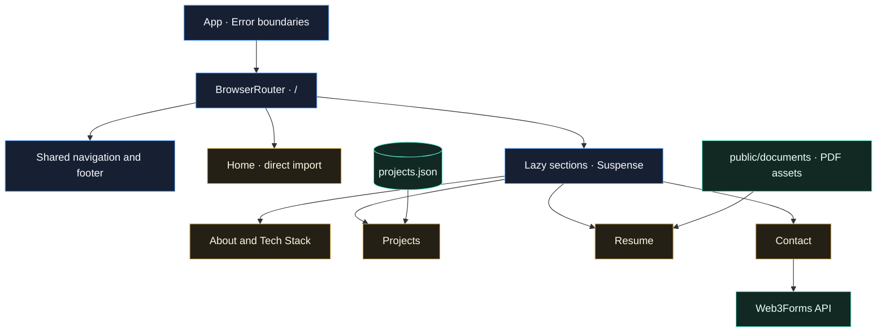
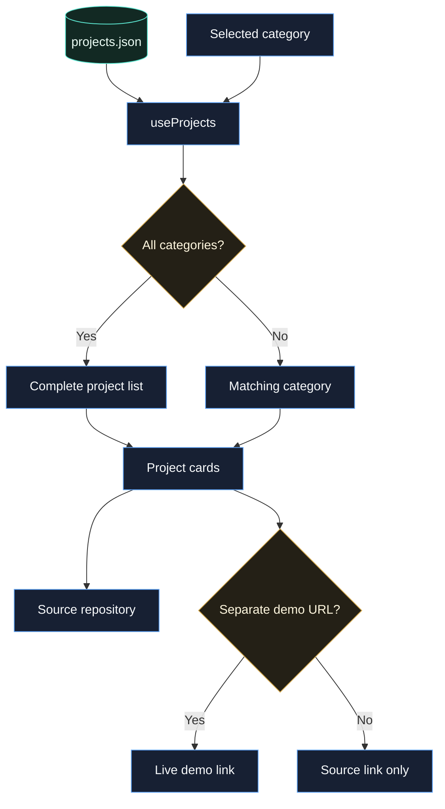

<div align="center">

# devfolio

### Nguyen Tran Gia Sĩ
**Java Backend Developer · Open to Internship & Junior Opportunities**

A personal portfolio presenting my projects, technical interests, and resume.

[View Portfolio](https://nguyentrangiasi.id.vn/) · [View Resume](public/documents/NguyenTranGiaSi_Intern_JAVA_Backend.pdf) · [Contact](mailto:giasinguyentran@gmail.com)


</div>

---

## About me

I'm **Nguyen Tran Gia Sĩ**, an IT student at the **Industrial University of Ho Chi Minh City**, based in **Ho Chi Minh City, Vietnam**. My focus is Java backend development with **Spring Boot**, alongside React interfaces for web projects.

I'm seeking **internship and junior developer opportunities** where I can contribute to a team, strengthen my backend engineering skills, and learn through practical development work.

This portfolio brings together project summaries, source links, technical skills, and a downloadable resume so recruiters and collaborators can explore my work in one place.

## Explore

- [Selected projects](#selected-projects)
- [Portfolio capabilities](#portfolio-capabilities)
- [Technology](#technology)
- [Architecture](#architecture)
- [Run locally](#run-locally)
- [Scripts](#scripts)
- [Deployment](#deployment)
- [Content maintenance](#content-maintenance)
- [Contact](#contact)
- [License](#license)

## Selected projects

The summaries, roles, technologies, and project destinations below are recorded in [the portfolio project data](src/data/projects.json). They describe the showcased projects; their implementations live in separate repositories.

| Project | Focus | Recorded role | Selected technologies | Explore |
| :--- | :--- | :--- | :--- | :--- |
| **Nexatech** | E-commerce: authentication, catalog, cart, orders, blog, and administration | Team Leader & Fullstack Developer | Spring Boot, Next.js, React, JWT | [Source](https://gitlab.com/software-architecture264301/e-commerce) |
| **Chatly** | Real-time messaging with direct and group conversations | Team Leader & Fullstack Developer | Spring Boot, WebSocket, React Native, PostgreSQL | [Source](https://github.com/giasinguyen/chatly-messaging-platform) |
| **Aurora Hotel Management** | Hotel operations, bookings, access control, and an AI chatbot | Team Leader & Backend Developer | Spring Boot, React, PostgreSQL, Redis | [Source](https://github.com/giasinguyen/aurora-hotel-management-system) · [Demo](https://www.aurorahotel.io.vn/) |
| **CodeHub** | Sharing and discovering code snippets | Fullstack Developer | Spring Boot, React, JWT, WebSocket, MariaDB | [Source](https://github.com/giasinguyen/CodeHub) |
| **NatureGrain** | Organic food e-commerce with product browsing, cart, and administration | Fullstack Developer | Spring Boot, React, JWT, MySQL | [Source](https://github.com/giasinguyen/NatureGrain) |

More entries are available in the website's Projects section. Demo links are included where the project data provides a separate website destination; external availability may vary.

## Portfolio capabilities

| Area | Implementation |
| :--- | :--- |
| **Introduction** | Home and About sections present background and development focus. |
| **Project discovery** | Category filters, project roles, technology tags, source links, and optional demo links. |
| **Technical profile** | A dedicated Tech Stack section. |
| **Resume** | Resume section and PDF assets under `public/documents/`. |
| **Contact** | Required-field validation, submission status, and success/error feedback through Web3Forms. |
| **Presentation** | Dark styling, responsive layouts, and Framer Motion transitions. |
| **Loading and recovery** | React lazy loading, Suspense fallbacks, and error boundaries. |

## Technology

### This website

| Layer | Technology | Source |
| :--- | :--- | :--- |
| UI | React 19, JavaScript / JSX | [App.jsx](src/App.jsx) |
| Routing | React Router 7 | [App.jsx](src/App.jsx) |
| Styling | Tailwind CSS 4, CSS | [Vite configuration](vite.config.js) |
| Animation | Framer Motion | [Projects component](src/components/Projects/Projects.jsx) |
| Project content | Local JSON and React hooks | [useProjects.js](src/hooks/useProjects.js) |
| Contact delivery | Web3Forms HTTP API | [Contact component](src/components/Contact/Contact.jsx) |
| Build tooling | Vite 6 | [package.json](package.json) |
| Code checks | ESLint 9 | [package.json](package.json) |
| Hosting configuration | Vercel, static `dist/` output | [vercel.json](vercel.json) |

Version numbers above reflect the major versions declared in `package.json`.

### Technologies represented in my projects

The project catalog includes **Java, Spring Boot, React, Next.js, React Native, JWT, WebSocket, PostgreSQL, MySQL, MariaDB, MongoDB, and Redis**. These belong to the showcased applications; the portfolio itself is a React frontend.

## Architecture

### Website composition

The application renders its portfolio sections on the `/` route. Home is imported directly; the remaining sections use lazy imports and Suspense.



### Project discovery

Filtering runs locally against the imported project data.



## Run locally

Use Node.js and npm compatible with the dependencies in [package-lock.json](package-lock.json). The project does not declare a Node.js version in an `engines` field.

```bash
git clone https://github.com/giasinguyen/devfolio.git
cd devfolio
npm ci --legacy-peer-deps
npm run dev
```

Open the local URL printed by Vite, normally **http://localhost:5173**. The install command matches the repository's Vercel configuration.

The contact form calls an external service. When adapting this portfolio, configure your own Web3Forms access key in [Contact.jsx](src/components/Contact/Contact.jsx) before using the form.

## Scripts

| Command | Purpose |
| :--- | :--- |
| `npm run dev` | Start the Vite development server. |
| `npm run build` | Build the website into `dist/`. |
| `npm run preview` | Serve the production build locally after building. |
| `npm run lint:check` | Check source files with ESLint without automatic fixes. |
| `npm run lint` | Run ESLint with automatic fixes; this may modify files. |
| `npm run clean` | Remove `dist/` and the Vite cache using a POSIX shell command. |
| `npm run build:prod` | Run clean, then build; requires a shell supporting `rm -rf`. |

## Deployment

[vercel.json](vercel.json) defines the deployment settings:

| Setting | Value |
| :--- | :--- |
| Framework | Vite |
| Install command | `npm ci --legacy-peer-deps` |
| Build command | `npm run build` |
| Output directory | `dist` |
| Application fallback | Requests rewrite to `/index.html` |

To inspect a production build locally:

```bash
npm run build
npm run preview
```

The portfolio URL recorded in this repository is **[nguyentrangiasi.id.vn](https://nguyentrangiasi.id.vn/)**.

## Content maintenance

| Update | Location |
| :--- | :--- |
| Introduction and background | [Home](src/components/Home/Home.jsx), [About](src/components/About/About.jsx) |
| Project descriptions, roles, categories, and destinations | [projects.json](src/data/projects.json) |
| Displayed skills | [TechStack.jsx](src/components/TechStack/TechStack.jsx) |
| Resume presentation and PDF references | [Resume.jsx](src/components/Resume/Resume.jsx) |
| Resume files | [public/documents](public/documents/) |
| Contact details and form integration | [Contact.jsx](src/components/Contact/Contact.jsx) |
| Page metadata | [seoConfigs.js](src/components/SEO/seoConfigs.js) |
| Build and deployment configuration | [vite.config.js](vite.config.js), [vercel.json](vercel.json) |

For changes, run the relevant lint and build commands and inspect the affected sections in the browser. Keep project descriptions and links aligned with the actual project repositories.

## Contact

**Nguyen Tran Gia Sĩ**  
Java backend development · Ho Chi Minh City, Vietnam

- **Email:** [giasinguyentran@gmail.com](mailto:giasinguyentran@gmail.com)
- **GitHub:** [@giasinguyen](https://github.com/giasinguyen)
- **LinkedIn:** [giasinguyen](https://linkedin.com/in/giasinguyen)
- **Portfolio:** [nguyentrangiasi.id.vn](https://nguyentrangiasi.id.vn/)
- **Resume:** [Java Backend Internship CV](public/documents/NguyenTranGiaSi_Intern_JAVA_Backend.pdf)

## License

This repository currently does not include a standalone license file. Contact the author for reuse permissions.

---

<div align="center">
  <sub>devfolio · Nguyen Tran Gia Sĩ</sub>
</div>
